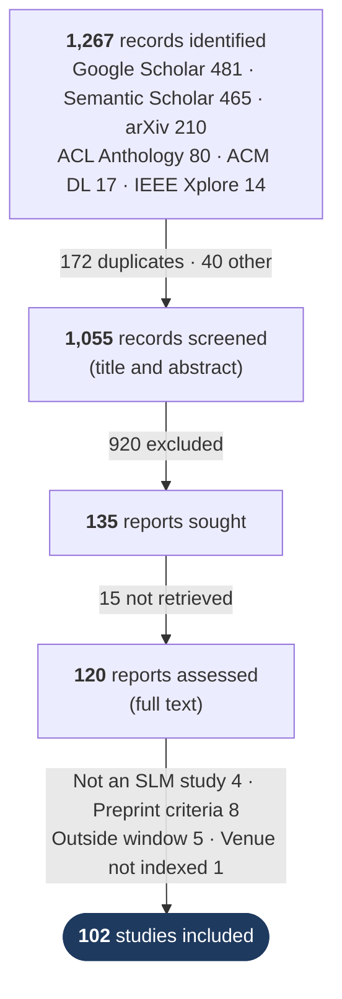
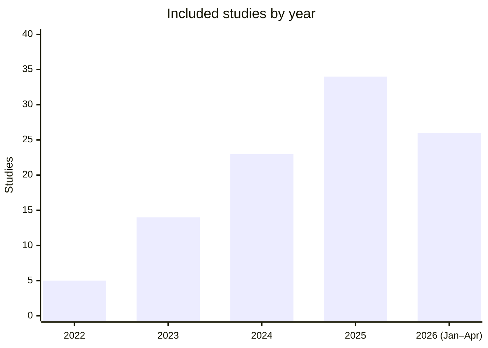
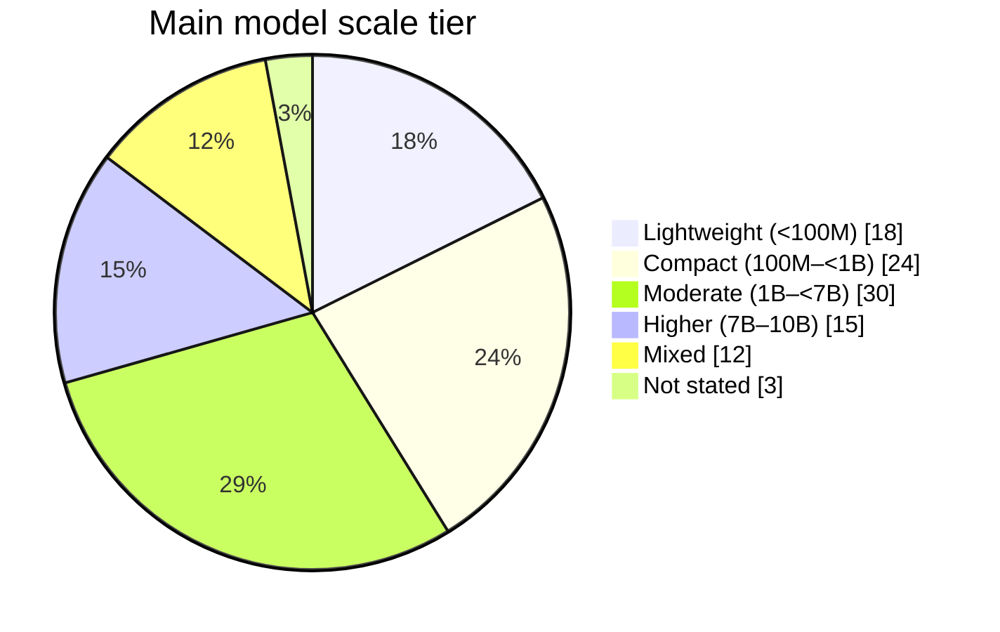

# Small Language Models: A Systematic Review (Dataset)

**102 studies · 27 countries · Jan 2022 to Apr 2026 · models up to 10B parameters**

This repository holds the data behind our systematic review of small language models (SLMs), published in *Big Data and Cognitive Computing*. Everything is in a single Excel file, **`SLM_Review_Dataset.xlsx`**. None of the counts in it are typed by hand: each one is a `COUNTIF`/`COUNTIFS` formula over the study rows, so clicking any number shows exactly how it was obtained.

---

## How we got from 1,267 records to 102 studies

Two reviewers screened every record independently. Before disagreements were resolved, they agreed on **97.6%** of records at title and abstract screening (κ = 0.90) and on **92.5%** at full text (κ = 0.67).

---

## A quick look at the corpus

| | |
|---|---|
| 🌍 **Where the work comes from** | United States 36 · China 22 · India 6 · Germany 5 · South Korea 4 · 22 other countries |
| 🧩 **Most studied domains** | NLP 19 · Agentic AI 17 · Coding 11 · Healthcare 9 · Robotics 9 |
| 📄 **Publication status** | 74 peer-reviewed · 28 preprints (included under criteria a, b or c) |
| ⚖️ **Near the 10B line** | 27 studies use a 7–10B model; 9 use only such models |

---

## What is in the workbook

<b>📘 <code>Included_102</code>: one row per included study</b>

 

| Column | Meaning |
|---|---|
| `Ref. no.` | Reference number in the published article |
| `Citation key`, `First author`, `Title`, `Year`, `Venue` | Bibliographic details |
| `Link` | DOI, publisher page or arXiv page (clickable) |
| `Status` / `Published version` | Peer-reviewed or preprint. For arXiv entries that were later published, this gives the venue |
| `Preprint criterion` + `Crit. a/b/c` | Why a preprint qualified: (a) code or weights released, (b) at least 5 citations, (c) technical report of a released model |
| `Model / Method`, `Models used`, `Models created`, `Model size` | What was studied or built |
| `Main tier` | Scale tier of the main model (colour-coded) |
| `Tiers covered (≤10B)`, `Uses 7–10B` | Every tier the study touches. Used for the sensitivity check |
| `Domain` | Application domain (Figure 4 and Tables 4–5) |
| `Training data`, `Evaluation data`, `Tasks`, `Key contribution` | Extracted study content |
| `Country (first author)` | Country of the first author's first-listed affiliation (Figure 2) |

Headers stay frozen and every column has a filter.

<b>🚫 <code>Excluded_18</code>: reports removed at full-text assessment</b>

 

The same bibliographic fields and link, plus the PRISMA reason category and a one-line explanation for each study. This lets anyone check every exclusion.

<b>🔀 <code>PRISMA_Flow</code>: every box of the flow diagram</b>

 

Counts from the search and screening log. The full-text exclusions and the final 102 are calculated from the two study sheets. A built-in check cell confirms that *assessed − excluded = included*.

<b>📊 <code>Summary</code>: every distribution in the paper</b>

 

Year, main tier, domain, tier × domain (Table 5), publication status, preprint criteria, the 7–10B sensitivity counts and first-author country, each with percentages and a chart. All of it updates from `Included_102`.

---

## Checking a number from the paper

| In the paper | Where to look |
|---|---|
| PRISMA flow diagram | `PRISMA_Flow` → column C |
| Figure 1: studies per year | `Summary` → Publication year |
| Figure 2: countries | `Summary` → First-author country |
| Figure 4: domains | `Summary` → Application domain |
| Table 4: all 102 included studies | `Included_102` (one row per study, grouped by `Domain`) |
| Table 5: tier × domain | `Summary` → Main tier × domain |
| Preprints and criteria a/b/c | `Summary` → Publication status, Preprint criteria |
| 7–10B sensitivity | `Summary` → Sensitivity |

To find the studies behind any count, filter the matching column in `Included_102`.

---

## Scale tiers used throughout

| 🟩 Lightweight | 🟨 Compact | 🟥 Moderate | 🟪 Higher |
|:---:|:---:|:---:|:---:|
| < 100M | 100M – < 1B | 1B – < 7B | 7B – 10B |

**Eligibility:** published 1 Jan 2022 – 30 Apr 2026. Indexed in Scopus, Web of Science, PubMed or DBLP, or published by IEEE, ACM, Elsevier, Springer or ACL. Preprints qualify only under criteria a, b or c.

---

## Citation

Will be updated later.

Data licensed under [CC BY 4.0](https://creativecommons.org/licenses/by/4.0/).
